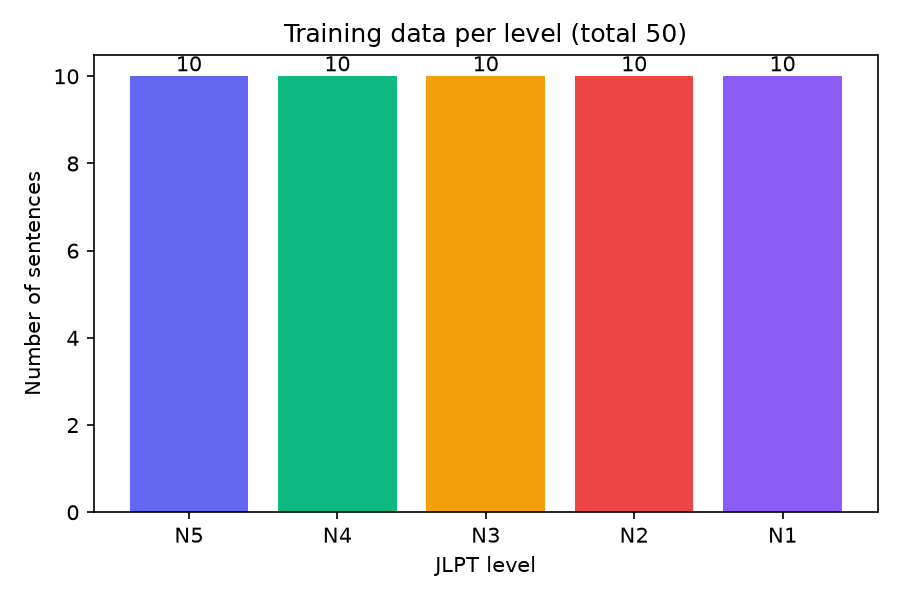
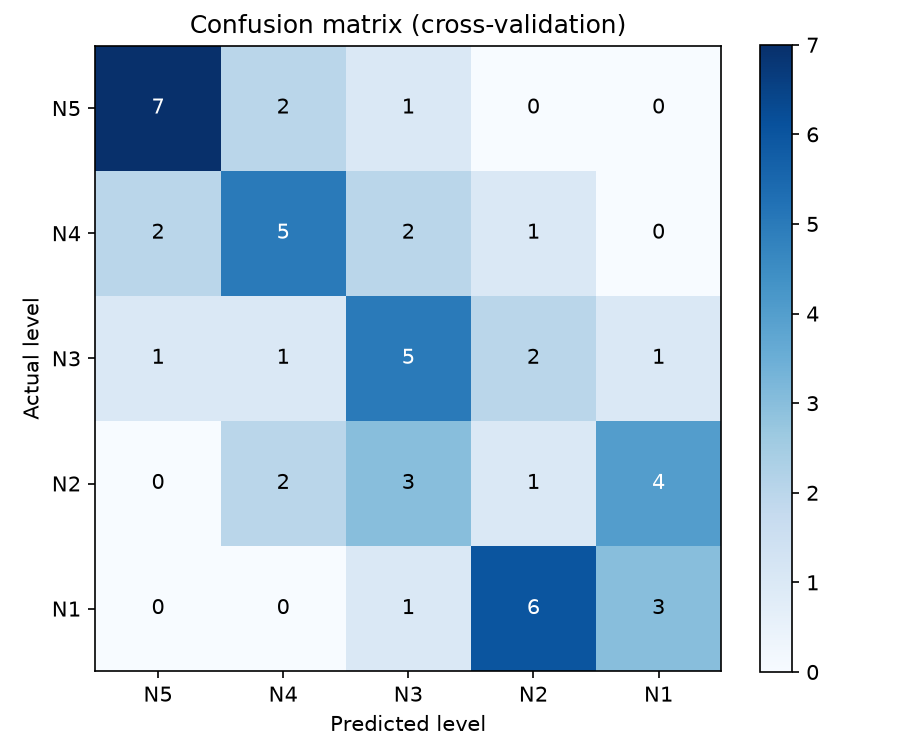

<!-- # JLPT N3 AI Study Partner

Aplikasi belajar bahasa Jepang (target JLPT N3) berbasis chat AI. Pengguna menulis kalimat Jepang atau pertanyaan, lalu **Sensei AI** membalas dengan kanji, hiragana, romaji, terjemahan, koreksi, dan perkiraan level JLPT.

Semua komponen berjalan **lokal di laptop, gratis, dan tanpa API token**.

## Fitur

- Chat dengan Sensei (LLM Llama lewat Ollama) dengan jawaban terstruktur: kanji, hiragana, romaji, terjemahan, dan penjelasan koreksi
- Pilihan bahasa terjemahan (Indonesia / Inggris), mudah ditambah
- Dua penilaian level JLPT untuk tiap jawaban: dari LLM (badge hijau) dan dari **model ML buatan sendiri** (badge ungu)
- Antarmuka dashboard: sidebar, area chat, panel riwayat, mode terang/gelap
- Laporan evaluasi model ML otomatis berupa grafik (matplotlib)

## Teknologi

| Bagian            | Teknologi                                                     |
| ----------------- | ------------------------------------------------------------- |
| Frontend          | React, Vite, Tailwind CSS v4, lucide-react                    |
| Backend           | Python, FastAPI, Uvicorn, Pydantic                            |
| LLM               | Llama via Ollama (API kompatibel OpenAI, klien `openai`)      |
| ML buatan sendiri | scikit-learn: TF-IDF (character n-gram) + Logistic Regression |
| Laporan           | pandas, matplotlib                                            |

## Arsitektur singkat

```
React (localhost:5173)
   │  POST /api/chat
   ▼
FastAPI (localhost:8000)
   ├── llm.py ──────► Ollama (localhost:11434)  → jawaban Sensei (JSON)
   └── ml/difficulty.py → model TF-IDF + LogReg → perkiraan level JLPT
   │
   ▼  JSON gabungan
React menampilkan bubble chat + badge level
```

## Struktur proyek dan penjelasan tiap file

```
japanese-ai-agent/
├── README.md
├── backend/
│   ├── .env
│   ├── .gitignore
│   ├── requirements.txt
│   ├── app/
│   │   ├── __init__.py
│   │   ├── main.py
│   │   ├── config.py
│   │   ├── prompts.py
│   │   ├── llm.py
│   │   ├── schemas.py
│   │   └── ml/
│   │       ├── __init__.py
│   │       ├── train.py
│   │       ├── difficulty.py
│   │       ├── add_data.py
│   │       ├── experiment.py
│   │       ├── learning_curve.py
│   │       ├── find_suspicious.py
│   │       ├── report.py
│   │       └── report_model.py
│   ├── data/
│   │   └── sentences.csv
│   ├── models/
│   │   └── jlpt_classifier.joblib
│   └── reports/
│       ├── 01_...07_*.png
│       ├── 08_top_ngrams_per_level.png
│       └── walkthroughs/
└── frontend/
    ├── .env
    ├── index.html
    ├── package.json
    ├── vite.config.js
    └── src/
        ├── main.jsx
        ├── index.css
        ├── App.jsx
        ├── services/
        │   └── api.js
        └── components/
            ├── Sidebar.jsx
            ├── RightPanel.jsx
            ├── Welcome.jsx
            ├── ChatInput.jsx
            └── ChatMessage.jsx
```

### Backend: konfigurasi

| File                       | Fungsi                                                                                                                                                       |
| -------------------------- | ------------------------------------------------------------------------------------------------------------------------------------------------------------ |
| `backend/.env`             | Pengaturan rahasia dan konfigurasi lokal: alamat Ollama (`LLM_BASE_URL`), nama model (`LLM_MODEL`), mode JSON (`LLM_JSON_MODE`). **Tidak di-commit ke Git.** |
| `backend/.gitignore`       | Daftar file yang diabaikan Git (`venv/`, `.env`, `__pycache__/`)                                                                                             |
| `backend/requirements.txt` | Daftar library Python yang dibutuhkan, dipakai untuk instalasi ulang dan deploy                                                                              |

### Backend: aplikasi API (`backend/app/`)

| File          | Fungsi                                                                                                                                                                     |
| ------------- | -------------------------------------------------------------------------------------------------------------------------------------------------------------------------- |
| `__init__.py` | File kosong yang menandai folder `app` sebagai package Python                                                                                                              |
| `main.py`     | Titik masuk FastAPI. Berisi endpoint `/api/health`, `/api/chat`, `/api/difficulty`, pengaturan CORS, dan penanganan error yang menghasilkan pesan jelas untuk pengguna     |
| `config.py`   | Membaca file `.env` dan menyediakan nilai konfigurasi ke bagian lain kode                                                                                                  |
| `prompts.py`  | System prompt Sensei: peran guru JLPT N3, aturan output JSON, dan contoh jawaban. Kualitas format jawaban sangat bergantung pada file ini                                  |
| `llm.py`      | Berkomunikasi dengan Ollama: mengirim prompt, mengambil JSON dari balasan model (`extract_json`), dan merapikan hasilnya (`normalize`) karena output LLM tidak selalu rapi |
| `schemas.py`  | Bentuk data masuk dan keluar API (Pydantic): `ChatRequest`, `ChatResponse`, `DifficultyRequest`. Pydantic otomatis menolak data yang tidak sesuai                          |

### Backend: modul ML (`backend/app/ml/`)

| File                 | Fungsi                                                                                                                                                              |
| -------------------- | ------------------------------------------------------------------------------------------------------------------------------------------------------------------- |
| `__init__.py`        | Penanda package Python                                                                                                                                              |
| `train.py`           | Melatih classifier dari `sentences.csv`, mengevaluasi dengan cross-validation, mencetak laporan akurasi dan confusion matrix, lalu menyimpan model ke `models/`     |
| `difficulty.py`      | Memuat model yang sudah dilatih dan memprediksi level kalimat (`predict_level`). Dipanggil oleh `main.py`                                                           |
| `add_data.py`        | Alat bantu terminal untuk menambah kalimat dan level baru ke `sentences.csv`                                                                                        |
| `experiment.py`      | Membandingkan beberapa konfigurasi model (n-gram, regularisasi, LinearSVC) dengan cross-validation                                                                  |
| `learning_curve.py`  | Mengukur akurasi saat jumlah data latih dinaikkan bertahap, untuk melihat apakah menambah data membantu                                                             |
| `find_suspicious.py` | Menampilkan kalimat yang ditebak berbeda dari labelnya, sebagai daftar periksa untuk memeriksa label yang mungkin salah                                             |
| `report.py`          | Membuat grafik evaluasi (distribusi data, confusion matrix, metrik per level, perbandingan baseline, perbandingan konfigurasi, learning curve) ke folder `reports/` |
| `report_model.py`    | Membuat grafik isi model: potongan karakter terpenting per level, dan alur prediksi untuk satu kalimat (disimpan per kalimat di `reports/walkthroughs/`)            |

### Backend: data, model, dan laporan

| Lokasi                          | Fungsi                                                                                                                                           |
| ------------------------------- | ------------------------------------------------------------------------------------------------------------------------------------------------ |
| `data/sentences.csv`            | **Data latih**: kalimat Jepang beserta levelnya (`text,level`). Sumber kebenaran, model dibangun ulang dari file ini setiap kali data diperbaiki |
| `models/jlpt_classifier.joblib` | Model hasil latihan (dibuat otomatis oleh `train.py`). Bisa dibuat ulang kapan saja, jadi tidak wajib masuk Git                                  |
| `reports/`                      | Grafik PNG hasil `report.py` dan `report_model.py`                                                                                               |
| `reports/walkthroughs/`         | Gambar alur prediksi per kalimat uji, plus `index.md` berisi daftar kalimat yang pernah diuji                                                    |

### Frontend

| File                             | Fungsi                                                                                                               |
| -------------------------------- | -------------------------------------------------------------------------------------------------------------------- |
| `frontend/.env`                  | Alamat backend (`VITE_API_URL=http://localhost:8000`). Variabel yang boleh dibaca browser wajib berawalan `VITE_`    |
| `index.html`                     | Halaman HTML dasar tempat React dipasang                                                                             |
| `package.json`                   | Daftar dependency dan perintah (`npm run dev`, `npm run build`)                                                      |
| `vite.config.js`                 | Konfigurasi Vite dan plugin Tailwind                                                                                 |
| `src/main.jsx`                   | Titik masuk React yang memasang komponen `App` ke halaman                                                            |
| `src/index.css`                  | Mengaktifkan Tailwind dan pengaturan mode gelap                                                                      |
| `src/App.jsx`                    | Komponen utama: menyimpan state (pesan, input, bahasa, tema), mengirim pesan ke backend, dan menyusun layout 3 kolom |
| `src/services/api.js`            | Fungsi `sendChat` yang memanggil backend lewat `fetch` dan meneruskan pesan error dari server                        |
| `src/components/Sidebar.jsx`     | Sidebar kiri: logo, pencarian, menu, tombol tema terang/gelap, profil                                                |
| `src/components/RightPanel.jsx`  | Panel kanan: daftar riwayat sesi                                                                                     |
| `src/components/Welcome.jsx`     | Tampilan sambutan dengan kartu aksi cepat (koreksi, kosakata, kuis, reading)                                         |
| `src/components/ChatInput.jsx`   | Kotak input chat dengan tombol kirim, penghitung karakter, dan Enter untuk mengirim                                  |
| `src/components/ChatMessage.jsx` | Bubble chat: menampilkan kanji, hiragana, romaji, terjemahan, penjelasan, serta badge level LLM dan ML               |

## Cara menjalankan

### Prasyarat

- Python 3.10 atau lebih baru
- Node.js 20 atau lebih baru
- [Ollama](https://ollama.com/download) dan satu model, misalnya `ollama pull llama3.1:8b` (RAM 16 GB) atau `ollama pull llama3.2:3b` (RAM 8 GB)

### 1. Backend

```bash
cd backend
python -m venv venv
venv\Scripts\activate
pip install -r requirements.txt
```

Buat `backend/.env`:

```
LLM_BASE_URL=http://localhost:11434/v1
LLM_API_KEY=ollama
LLM_MODEL=llama3.1:8b
LLM_JSON_MODE=1
```

Latih model ML, lalu jalankan server:

```bash
python -m app.ml.train
uvicorn app.main:app --reload --port 8000
```

### 2. Frontend

```bash
cd frontend
npm install
npm run dev
```

Buat `frontend/.env`:

```
VITE_API_URL=http://localhost:8000
```

Buka `http://localhost:5173`. Pastikan Ollama aktif di latar belakang.

## Endpoint API

| Method | Path              | Fungsi                                                     |
| ------ | ----------------- | ---------------------------------------------------------- |
| GET    | `/api/health`     | Cek status, nama model, dan alamat LLM                     |
| POST   | `/api/chat`       | Kirim pesan, terima jawaban Sensei dalam JSON              |
| POST   | `/api/difficulty` | Prediksi level JLPT sebuah kalimat dengan model ML sendiri |

Dokumentasi interaktif tersedia di `http://localhost:8000/docs`.

## JLPT Difficulty Classifier (model ML buatan sendiri)

Memprediksi level JLPT (N5 sampai N1) sebuah kalimat Jepang. Berjalan di CPU, tanpa GPU dan tanpa API eksternal.

**Pipeline:** character n-gram TF-IDF (1-3) lalu Logistic Regression (scikit-learn).

Bahasa Jepang tidak memakai spasi antar kata, jadi kalimat dipotong per karakter (1 sampai 3 karakter). TF-IDF memberi bobot besar pada potongan yang jarang muncul di kalimat lain, dan Logistic Regression mempelajari potongan mana yang condong ke level mana.

**Data:** N kalimat berlabel di `backend/data/sentences.csv` (jumlah per level seimbang). Label berasal dari materi belajar JLPT dan diperiksa manual.

### Evaluasi

5-fold stratified cross-validation, seed 42.

| Metrik                 | Hasil | Baseline acak |
| ---------------------- | ----- | ------------- |
| Akurasi persis         | XX%   | 20%           |
| Akurasi dalam ±1 level | XX%   | sekitar 52%   |

Ganti `N` dan `XX%` dengan angka dari hasil `python -m app.ml.train` terbarumu.


### Apa yang dipelajari model

Potongan karakter dengan bobot tertinggi untuk tiap level:


### Contoh alur prediksi per kalimat

Ganti nama file di bawah dengan nama yang muncul di `backend/reports/walkthroughs/` (atau salin dari `index.md` di folder itu).


### Cara mengulang eksperimen

```bash
python -m app.ml.train
python -m app.ml.experiment
python -m app.ml.learning_curve
python -m app.ml.find_suspicious
python -m app.ml.report
python -m app.ml.report_model "kalimat Jepang yang ingin diuji"
```

### Keterbatasan

- Model mengenali pola karakter permukaan, bukan makna atau aturan tata bahasa
- Kesalahan umumnya terjadi antar level bersebelahan (terutama N3, N2, N1)
- Data masih sedikit, jadi skor keyakinan hanya perkiraan kasar
- Label level berasal dari sumber belajar yang tidak seragam, karena tidak ada daftar tata bahasa resmi per level

### Rencana pengembangan

- Menambah data hingga 250 kalimat atau lebih lalu mengevaluasi ulang
- Menambah fitur analisis morfologi (tokenizer bahasa Jepang)
- Database SQLite untuk kosakata, kanji, dan grammar N3
- Router Agent, Vocabulary Tool, dan Quiz Agent
- RAG dari basis pengetahuan JLPT

## Catatan

- Model LLM berjalan lokal lewat Ollama. Panggilan pertama bisa lambat karena model dimuat ke memori.
- Hasil LLM ukuran kecil bisa keliru pada hiragana, romaji, dan koreksi. Cek ulang tata bahasa penting ke sumber resmi.
- Aplikasi ini hanya berjalan lokal. Versi online memerlukan LLM berbasis cloud karena Ollama di laptop tidak bisa diakses dari hosting. -->

# JLPT N3 AI Study Partner

Aplikasi belajar bahasa Jepang (target JLPT N3) berbasis chat AI. Pengguna menulis kalimat Jepang atau pertanyaan, lalu **Sensei AI** membalas dengan kanji, hiragana, romaji, terjemahan, koreksi, dan perkiraan level JLPT.

Semua komponen berjalan **lokal di laptop, gratis, dan tanpa API token**.

## Fitur

- Chat dengan Sensei (LLM Llama lewat Ollama) dengan jawaban terstruktur: kanji, hiragana, romaji, terjemahan, dan penjelasan koreksi
- Pilihan bahasa terjemahan (Indonesia / Inggris), mudah ditambah
- Dua penilaian level JLPT untuk tiap jawaban: dari LLM (badge hijau) dan dari **model ML buatan sendiri** (badge ungu)
- Antarmuka dashboard: sidebar, area chat, panel riwayat, mode terang/gelap
- Laporan evaluasi model ML otomatis berupa grafik (matplotlib)

## Teknologi

| Bagian            | Teknologi                                                     |
| ----------------- | ------------------------------------------------------------- |
| Frontend          | React, Vite, Tailwind CSS v4, lucide-react                    |
| Backend           | Python, FastAPI, Uvicorn, Pydantic                            |
| LLM               | Llama via Ollama (API kompatibel OpenAI, klien `openai`)      |
| ML buatan sendiri | scikit-learn: TF-IDF (character n-gram) + Logistic Regression |
| Laporan           | pandas, matplotlib                                            |

## Arsitektur singkat

```
React (localhost:5173)
   │  POST /api/chat
   ▼
FastAPI (localhost:8000)
   ├── llm.py ──────► Ollama (localhost:11434)  → jawaban Sensei (JSON)
   └── ml/difficulty.py → model TF-IDF + LogReg → perkiraan level JLPT
   │
   ▼  JSON gabungan
React menampilkan bubble chat + badge level
```

## Struktur proyek dan penjelasan tiap file

```
japanese-ai-agent/
├── README.md
├── backend/
│   ├── .env
│   ├── .gitignore
│   ├── requirements.txt
│   ├── app/
│   │   ├── __init__.py
│   │   ├── main.py
│   │   ├── config.py
│   │   ├── prompts.py
│   │   ├── llm.py
│   │   ├── schemas.py
│   │   └── ml/
│   │       ├── __init__.py
│   │       ├── train.py
│   │       ├── difficulty.py
│   │       ├── add_data.py
│   │       ├── experiment.py
│   │       ├── learning_curve.py
│   │       ├── find_suspicious.py
│   │       ├── report.py
│   │       └── report_model.py
│   ├── data/
│   │   └── sentences.csv
│   ├── models/
│   │   └── jlpt_classifier.joblib
│   └── reports/
│       ├── 01_...07_*.png
│       ├── 08_top_ngrams_per_level.png
│       └── walkthroughs/
└── frontend/
    ├── .env
    ├── index.html
    ├── package.json
    ├── vite.config.js
    └── src/
        ├── main.jsx
        ├── index.css
        ├── App.jsx
        ├── services/
        │   └── api.js
        └── components/
            ├── Sidebar.jsx
            ├── RightPanel.jsx
            ├── Welcome.jsx
            ├── ChatInput.jsx
            └── ChatMessage.jsx
```

### Backend: konfigurasi

| File                       | Fungsi                                                                                                                                                       |
| -------------------------- | ------------------------------------------------------------------------------------------------------------------------------------------------------------ |
| `backend/.env`             | Pengaturan rahasia dan konfigurasi lokal: alamat Ollama (`LLM_BASE_URL`), nama model (`LLM_MODEL`), mode JSON (`LLM_JSON_MODE`). **Tidak di-commit ke Git.** |
| `backend/.gitignore`       | Daftar file yang diabaikan Git (`venv/`, `.env`, `__pycache__/`)                                                                                             |
| `backend/requirements.txt` | Daftar library Python yang dibutuhkan, dipakai untuk instalasi ulang dan deploy                                                                              |

### Backend: aplikasi API (`backend/app/`)

| File          | Fungsi                                                                                                                                                                     |
| ------------- | -------------------------------------------------------------------------------------------------------------------------------------------------------------------------- |
| `__init__.py` | File kosong yang menandai folder `app` sebagai package Python                                                                                                              |
| `main.py`     | Titik masuk FastAPI. Berisi endpoint `/api/health`, `/api/chat`, `/api/difficulty`, pengaturan CORS, dan penanganan error yang menghasilkan pesan jelas untuk pengguna     |
| `config.py`   | Membaca file `.env` dan menyediakan nilai konfigurasi ke bagian lain kode                                                                                                  |
| `prompts.py`  | System prompt Sensei: peran guru JLPT N3, aturan output JSON, dan contoh jawaban. Kualitas format jawaban sangat bergantung pada file ini                                  |
| `llm.py`      | Berkomunikasi dengan Ollama: mengirim prompt, mengambil JSON dari balasan model (`extract_json`), dan merapikan hasilnya (`normalize`) karena output LLM tidak selalu rapi |
| `schemas.py`  | Bentuk data masuk dan keluar API (Pydantic): `ChatRequest`, `ChatResponse`, `DifficultyRequest`. Pydantic otomatis menolak data yang tidak sesuai                          |

### Backend: modul ML (`backend/app/ml/`)

| File                 | Fungsi                                                                                                                                                              |
| -------------------- | ------------------------------------------------------------------------------------------------------------------------------------------------------------------- |
| `__init__.py`        | Penanda package Python                                                                                                                                              |
| `train.py`           | Melatih classifier dari `sentences.csv`, mengevaluasi dengan cross-validation, mencetak laporan akurasi dan confusion matrix, lalu menyimpan model ke `models/`     |
| `difficulty.py`      | Memuat model yang sudah dilatih dan memprediksi level kalimat (`predict_level`). Dipanggil oleh `main.py`                                                           |
| `add_data.py`        | Alat bantu terminal untuk menambah kalimat dan level baru ke `sentences.csv`                                                                                        |
| `experiment.py`      | Membandingkan beberapa konfigurasi model (n-gram, regularisasi, LinearSVC) dengan cross-validation                                                                  |
| `learning_curve.py`  | Mengukur akurasi saat jumlah data latih dinaikkan bertahap, untuk melihat apakah menambah data membantu                                                             |
| `find_suspicious.py` | Menampilkan kalimat yang ditebak berbeda dari labelnya, sebagai daftar periksa untuk memeriksa label yang mungkin salah                                             |
| `report.py`          | Membuat grafik evaluasi (distribusi data, confusion matrix, metrik per level, perbandingan baseline, perbandingan konfigurasi, learning curve) ke folder `reports/` |
| `report_model.py`    | Membuat grafik isi model: potongan karakter terpenting per level, dan alur prediksi untuk satu kalimat (disimpan per kalimat di `reports/walkthroughs/`)            |

### Backend: data, model, dan laporan

| Lokasi                          | Fungsi                                                                                                                                           |
| ------------------------------- | ------------------------------------------------------------------------------------------------------------------------------------------------ |
| `data/sentences.csv`            | **Data latih**: kalimat Jepang beserta levelnya (`text,level`). Sumber kebenaran, model dibangun ulang dari file ini setiap kali data diperbaiki |
| `models/jlpt_classifier.joblib` | Model hasil latihan (dibuat otomatis oleh `train.py`). Bisa dibuat ulang kapan saja, jadi tidak wajib masuk Git                                  |
| `reports/`                      | Grafik PNG hasil `report.py` dan `report_model.py`                                                                                               |
| `reports/walkthroughs/`         | Gambar alur prediksi per kalimat uji, plus `index.md` berisi daftar kalimat yang pernah diuji                                                    |

### Frontend

| File                             | Fungsi                                                                                                               |
| -------------------------------- | -------------------------------------------------------------------------------------------------------------------- |
| `frontend/.env`                  | Alamat backend (`VITE_API_URL=http://localhost:8000`). Variabel yang boleh dibaca browser wajib berawalan `VITE_`    |
| `index.html`                     | Halaman HTML dasar tempat React dipasang                                                                             |
| `package.json`                   | Daftar dependency dan perintah (`npm run dev`, `npm run build`)                                                      |
| `vite.config.js`                 | Konfigurasi Vite dan plugin Tailwind                                                                                 |
| `src/main.jsx`                   | Titik masuk React yang memasang komponen `App` ke halaman                                                            |
| `src/index.css`                  | Mengaktifkan Tailwind dan pengaturan mode gelap                                                                      |
| `src/App.jsx`                    | Komponen utama: menyimpan state (pesan, input, bahasa, tema), mengirim pesan ke backend, dan menyusun layout 3 kolom |
| `src/services/api.js`            | Fungsi `sendChat` yang memanggil backend lewat `fetch` dan meneruskan pesan error dari server                        |
| `src/components/Sidebar.jsx`     | Sidebar kiri: logo, pencarian, menu, tombol tema terang/gelap, profil                                                |
| `src/components/RightPanel.jsx`  | Panel kanan: daftar riwayat sesi                                                                                     |
| `src/components/Welcome.jsx`     | Tampilan sambutan dengan kartu aksi cepat (koreksi, kosakata, kuis, reading)                                         |
| `src/components/ChatInput.jsx`   | Kotak input chat dengan tombol kirim, penghitung karakter, dan Enter untuk mengirim                                  |
| `src/components/ChatMessage.jsx` | Bubble chat: menampilkan kanji, hiragana, romaji, terjemahan, penjelasan, serta badge level LLM dan ML               |

## Cara menjalankan

### Prasyarat

- Python 3.10 atau lebih baru
- Node.js 20 atau lebih baru
- [Ollama](https://ollama.com/download) dan satu model, misalnya `ollama pull llama3.1:8b` (RAM 16 GB) atau `ollama pull llama3.2:3b` (RAM 8 GB)

### 1. Backend

```bash
cd backend
python -m venv venv
venv\Scripts\activate
pip install -r requirements.txt
```

Buat `backend/.env`:

```
LLM_BASE_URL=http://localhost:11434/v1
LLM_API_KEY=ollama
LLM_MODEL=llama3.1:8b
LLM_JSON_MODE=1
```

Latih model ML, lalu jalankan server:

```bash
python -m app.ml.train
uvicorn app.main:app --reload --port 8000
```

### 2. Frontend

```bash
cd frontend
npm install
npm run dev
```

Buat `frontend/.env`:

```
VITE_API_URL=http://localhost:8000
```

Buka `http://localhost:5173`. Pastikan Ollama aktif di latar belakang.

## Endpoint API

| Method | Path              | Fungsi                                                     |
| ------ | ----------------- | ---------------------------------------------------------- |
| GET    | `/api/health`     | Cek status, nama model, dan alamat LLM                     |
| POST   | `/api/chat`       | Kirim pesan, terima jawaban Sensei dalam JSON              |
| POST   | `/api/difficulty` | Prediksi level JLPT sebuah kalimat dengan model ML sendiri |

Dokumentasi interaktif tersedia di `http://localhost:8000/docs`.

## JLPT Difficulty Classifier (model ML buatan sendiri)

Memprediksi level JLPT (N5 sampai N1) sebuah kalimat Jepang. Berjalan di CPU, tanpa GPU dan tanpa API eksternal.

**Pipeline:** character n-gram TF-IDF (1-3) lalu Logistic Regression (scikit-learn).

Bahasa Jepang tidak memakai spasi antar kata, jadi kalimat dipotong per karakter (1 sampai 3 karakter). TF-IDF memberi bobot besar pada potongan yang jarang muncul di kalimat lain, dan Logistic Regression mempelajari potongan mana yang condong ke level mana.

**Data:** N kalimat berlabel di `backend/data/sentences.csv` (jumlah per level seimbang). Label berasal dari materi belajar JLPT dan diperiksa manual.

### Evaluasi

5-fold stratified cross-validation, seed 42.

| Metrik                 | Hasil | Baseline acak |
| ---------------------- | ----- | ------------- |
| Akurasi persis         | XX%   | 20%           |
| Akurasi dalam ±1 level | XX%   | sekitar 52%   |

Ganti `N` dan `XX%` dengan angka dari hasil `python -m app.ml.train` terbarumu.

### Cara membaca grafik evaluasi

Grafik 01 sampai 07 dibuat ulang oleh `report.py` dari `sentences.csv` setiap kali dijalankan. Angka performa dihitung dengan **cross-validation**: data dibagi 5 bagian, model dilatih dengan 4 bagian lalu diuji pada 1 bagian yang belum pernah dilihatnya, diulang sampai semua data pernah jadi data uji. Jadi grafik mengukur kemampuan menebak kalimat baru, bukan kemampuan menghafal.

Setiap grafik di bawah dijelaskan dengan empat bagian: apa yang ditampilkan, cara membacanya, hal yang perlu diperhatikan, dan temuan pada data saat ini. Bagian **Temuan** berisi isian `XX` yang perlu kamu ganti dengan hasil nyata dari gambar terbarumu.

#### 1. Distribusi data per level



**Yang ditampilkan:** jumlah kalimat latih untuk tiap level (N5 sampai N1) dalam bentuk diagram batang, dengan total data di judul grafik.

**Cara membaca:** batang yang sama tinggi berarti data seimbang. Batang yang jauh lebih pendek berarti level itu kekurangan contoh.

**Hal yang perlu diperhatikan:**

- Data tidak seimbang membuat model condong menebak level yang datanya paling banyak.
- Pengaturan `class_weight="balanced"` pada model hanya mengurangi efeknya, tidak menggantikan data yang cukup.
- Grafik ini sebaiknya dicek lebih dulu sebelum membaca grafik lain, karena ketidakseimbangan data bisa memengaruhi semua angka di bawahnya.

**Temuan pada data saat ini:** total `XX` kalimat, tiap level berisi `XX` kalimat (seimbang / tidak seimbang).

#### 2. Confusion matrix



**Yang ditampilkan:** tabel berwarna yang membandingkan level asli (baris) dengan level yang ditebak model (kolom). Angka di tiap sel adalah jumlah kalimat.

**Cara membaca:**

- Diagonal dari kiri atas ke kanan bawah adalah tebakan yang **benar**. Makin pekat warnanya, makin baik.
- Sel di luar diagonal adalah kesalahan. Contoh: baris N3 kolom N2 berisi jumlah kalimat N3 yang salah ditebak sebagai N2.
- Kesalahan di sel yang dekat diagonal (level bersebelahan) lebih ringan daripada sel yang jauh (misalnya N5 ditebak N1).

**Hal yang perlu diperhatikan:** cari baris yang paling "menyebar". Level itu paling sulit bagi model, dan biasanya butuh tambahan data atau fitur yang lebih kaya.

**Temuan pada data saat ini:** kesalahan terbanyak terjadi antara `XX` dan `XX`; level yang paling sering benar adalah `XX`.

#### 3. Precision, recall, dan F1 per level


**Yang ditampilkan:** tiga ukuran kualitas untuk tiap level dalam batang berkelompok.

**Cara membaca:**

- **Precision**: dari semua kalimat yang diprediksi sebagai level ini, berapa persen yang memang level ini (seberapa bisa dipercaya).
- **Recall**: dari semua kalimat yang aslinya level ini, berapa persen yang berhasil ditemukan model (seberapa lengkap).
- **F1-score**: ringkasan gabungan precision dan recall dalam satu angka.
- Nilai 1,0 sempurna dan 0 terburuk.

**Hal yang perlu diperhatikan:** precision tinggi tapi recall rendah berarti model berhati-hati (jarang menebak level itu, tapi sekali menebak biasanya benar). Kebalikannya berarti model terlalu sering menebak level itu.

**Temuan pada data saat ini:** level dengan F1 tertinggi adalah `XX` (`XX`), terendah adalah `XX` (`XX`).

#### 4. Akurasi dibanding tebakan acak


**Yang ditampilkan:** dua kelompok batang. Kelompok pertama adalah akurasi persis (level tepat sama), kelompok kedua adalah akurasi dalam ±1 level (tepat atau meleset satu level). Di tiap kelompok, batang ungu adalah model dan batang abu-abu adalah tebakan acak.

**Cara membaca:**

- Tebakan acak untuk 5 level menghasilkan sekitar **20%** pada akurasi persis dan sekitar **52%** pada akurasi ±1 level.
- Model dianggap berguna kalau batang ungu jelas di atas batang abu-abu.
- Akurasi ±1 level adalah ukuran tambahan di proyek ini, karena meleset satu level jauh lebih bisa diterima daripada meleset tiga level.

**Hal yang perlu diperhatikan:** jarak antara batang ungu dan abu-abu lebih penting daripada angka mutlaknya. Akurasi persis yang rendah tapi akurasi ±1 level yang tinggi berarti model menangkap arah kesulitan, tetapi belum bisa membedakan level yang berdekatan.

**Temuan pada data saat ini:** akurasi persis `XX%` (acak 20%), akurasi ±1 level `XX%` (acak sekitar 52%).

#### 5. Perbandingan konfigurasi model


**Yang ditampilkan:** enam konfigurasi yang diuji dengan cara yang sama: variasi rentang n-gram karakter (1-2, 1-3, 1-4, 2-4), nilai regularisasi `C` pada Logistic Regression, dan algoritma pembanding LinearSVC. Setiap konfigurasi punya dua batang: akurasi persis dan akurasi ±1 level.

**Cara membaca:** bandingkan tinggi batang antar konfigurasi pada ukuran yang sama.

**Hal yang perlu diperhatikan:**

- Pada data kecil, satu kalimat bisa mengubah akurasi beberapa poin persen, jadi selisih kecil antar konfigurasi adalah **noise**, bukan pemenang yang sebenarnya.
- Kalau semua batang hampir sama tinggi, berarti pemilihan konfigurasi bukan faktor penentu. Hambatannya ada di jumlah data atau jenis fitur.
- Konfigurasi bawaan yang dipakai di aplikasi adalah character n-gram (1-3) dengan Logistic Regression `C=5`.

**Temuan pada data saat ini:** selisih akurasi antar konfigurasi hanya `XX` poin persen, sehingga konfigurasi bawaan dipertahankan (atau: konfigurasi `XX` lebih baik sebesar `XX` poin).

#### 6. Learning curve


**Yang ditampilkan:** akurasi validasi saat jumlah data latih dinaikkan bertahap. Sumbu X adalah jumlah kalimat latih, sumbu Y adalah akurasi. Garis ungu adalah rata-rata, pita ungu muda adalah variasi (±1 simpangan baku) antar lipatan cross-validation, dan garis putus-putus abu-abu adalah tebakan acak.

**Cara membaca:**

- Garis yang **masih naik** di ujung kanan berarti model belum "kenyang" dan menambah data kemungkinan besar membantu.
- Garis yang **mendatar** berarti menambah data dengan pola yang sama tidak banyak membantu. Saat itu perlu fitur atau pendekatan yang lebih kaya.
- Pita yang lebar berarti hasilnya belum stabil.

**Hal yang perlu diperhatikan:** pada data kecil kurva bisa naik turun tidak mulus. Yang bisa dipercaya adalah arah umumnya, bukan setiap titik.

**Temuan pada data saat ini:** akurasi naik dari `XX%` (`XX` kalimat) ke `XX%` (`XX` kalimat), dan kurva `XX` (masih naik / mulai mendatar).

#### 7. Probabilitas untuk contoh kalimat


**Yang ditampilkan:** probabilitas yang diberikan model ke tiap level untuk tiga kalimat contoh (S1 sampai S3). Ketiga kalimat tidak ada di data latih. Teks kalimat dicantumkan di bawah dan tidak ada di grafik, agar tidak bermasalah dengan font.

| Kode | Kalimat                                    |
| ---- | ------------------------------------------ |
| S1   | 私は毎朝パンを食べます。                   |
| S2   | 雨が降りそうなので、出かけないことにした。 |
| S3   | 彼の発言は看過しがたいものがある。         |

**Cara membaca:**

- Batang tertinggi adalah level yang diprediksi.
- Jika satu batang jauh lebih tinggi dari yang lain, model relatif yakin.
- Jika batang tersebar hampir rata, model ragu.

**Hal yang perlu diperhatikan:** probabilitas ini adalah skor internal model, bukan jaminan kebenaran. Dengan data kecil, model bisa terlihat yakin padahal salah. Contoh ini berguna untuk menilai apakah arah prediksinya masuk akal (kalimat sederhana cenderung ke level rendah, kalimat rumit cenderung ke level tinggi), bukan untuk mengukur akurasi.

**Temuan pada data saat ini:** S1 diprediksi `XX` (`XX%`), S2 diprediksi `XX` (`XX%`), S3 diprediksi `XX` (`XX%`).

### Apa yang dipelajari model


**Yang ditampilkan:** lima panel, satu untuk tiap level. Tiap panel berisi 10 potongan karakter (1 sampai 3 karakter) dengan bobot tertinggi untuk level itu, diambil dari koefisien Logistic Regression. Gambar ini hanya bergantung pada data latih, bukan pada kalimat uji tertentu.

**Cara membaca:**

- Batang yang lebih panjang berarti potongan itu lebih kuat mendorong prediksi ke level tersebut.
- Potongan yang berupa pola tata bahasa asli (misalnya akhiran khas level tertentu) adalah tanda model belajar hal yang bermakna.
- Potongan yang tampak acak, berupa nama, atau kata yang hanya ada di satu kalimat adalah tanda model **menghafal** data karena contohnya terlalu sedikit.

**Hal yang perlu diperhatikan:** dengan data kecil, sebagian besar potongan teratas mungkin berasal dari satu atau dua kalimat saja. Itu bukan kesalahan kode, melainkan sinyal bahwa data perlu ditambah dan diperbanyak per pola tata bahasa.

**Temuan pada data saat ini:** potongan teratas untuk N2 adalah `XX`, `XX`, `XX`; untuk N5 adalah `XX`, `XX`, `XX`. Dari 5 level, `XX` level menampilkan pola yang masuk akal dan `XX` level terlihat seperti hafalan.

### Contoh alur prediksi per kalimat

Setiap kalimat uji menghasilkan satu gambar sendiri. Ganti nama file di bawah dengan nama yang muncul di `backend/reports/walkthroughs/` (atau salin dari `index.md` di folder itu).


**Yang ditampilkan:** satu gambar berisi tiga panel yang menunjukkan perjalanan sebuah kalimat dari awal sampai prediksi.

| Panel  | Judul                              | Isi                                                                               |
| ------ | ---------------------------------- | --------------------------------------------------------------------------------- |
| Kiri   | 1. Bobot TF-IDF                    | 12 potongan karakter dengan bobot TF-IDF tertinggi di kalimat itu                 |
| Tengah | 2. Kontribusi ke level terprediksi | Seberapa besar tiap potongan mendorong prediksi (bobot TF-IDF dikali bobot model) |
| Kanan  | 3. Probabilitas tiap level         | Probabilitas akhir semua level, level terpilih berwarna ungu                      |

**Cara membaca:**

- Panel kiri menjawab "bagian kalimat mana yang paling menonjol". Potongan yang jarang ada di data latih bobotnya besar.
- Panel tengah menjawab "bagian mana yang paling mendorong ke level yang dipilih". Ini penjelasan alasan prediksi.
- Panel kanan menjawab "seberapa yakin model". Bandingkan tinggi batang ungu dengan batang lain.

**Hal yang perlu diperhatikan:**

- Kontribusi di panel tengah tidak termasuk nilai dasar (intercept) model, sehingga jumlahnya tidak persis sama dengan skor akhir.
- Kalau potongan penentu berupa pola tata bahasa yang masuk akal, prediksinya punya dasar yang jelas. Kalau berupa potongan acak, prediksi itu lebih mirip kebetulan.
- Gambar ini cocok dipakai untuk menjelaskan keputusan model satu kalimat demi satu kalimat.

**Temuan pada data saat ini:** kalimat 1 diprediksi `XX` dengan potongan penentu `XX`, `XX`. Kalimat 2 diprediksi `XX` dengan potongan penentu `XX`, `XX`.

### Cara mengulang eksperimen

```bash
python -m app.ml.train
python -m app.ml.experiment
python -m app.ml.learning_curve
python -m app.ml.find_suspicious
python -m app.ml.report
python -m app.ml.report_model "kalimat Jepang yang ingin diuji"
```

### Keterbatasan

- Model mengenali pola karakter permukaan, bukan makna atau aturan tata bahasa
- Kesalahan umumnya terjadi antar level bersebelahan (terutama N3, N2, N1)
- Data masih sedikit, jadi skor keyakinan hanya perkiraan kasar
- Label level berasal dari sumber belajar yang tidak seragam, karena tidak ada daftar tata bahasa resmi per level

### Rencana pengembangan

- Menambah data hingga 250 kalimat atau lebih lalu mengevaluasi ulang
- Menambah fitur analisis morfologi (tokenizer bahasa Jepang)
- Database SQLite untuk kosakata, kanji, dan grammar N3
- Router Agent, Vocabulary Tool, dan Quiz Agent
- RAG dari basis pengetahuan JLPT

## Catatan

- Model LLM berjalan lokal lewat Ollama. Panggilan pertama bisa lambat karena model dimuat ke memori.
- Hasil LLM ukuran kecil bisa keliru pada hiragana, romaji, dan koreksi. Cek ulang tata bahasa penting ke sumber resmi.
- Aplikasi ini hanya berjalan lokal. Versi online memerlukan LLM berbasis cloud karena Ollama di laptop tidak bisa diakses dari hosting.
