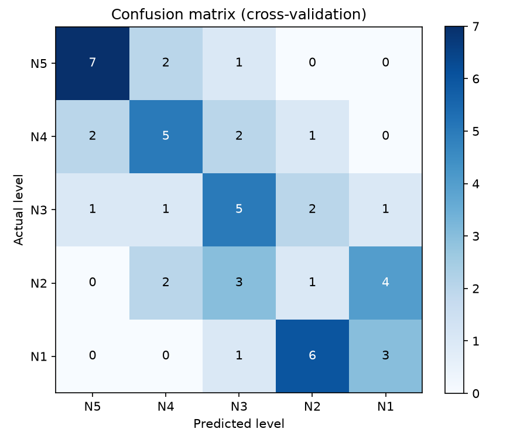
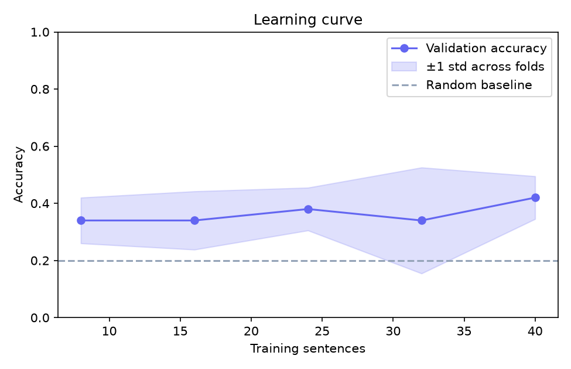
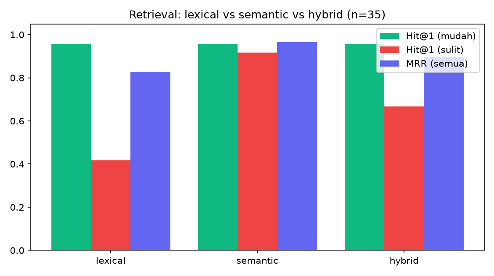

# JLPT N3 AI Study Partner (Sensei AI)

Asisten belajar bahasa Jepang untuk persiapan JLPT N3. Pengguna menulis kalimat Jepang atau bertanya dalam bahasa Indonesia atau Inggris, lalu **Sensei AI** mengoreksi, mengobrol, menjelaskan tata bahasa, dan membuat kuis. Semua komponen berjalan **lokal di laptop, gratis, dan tanpa API token**.

> Proyek belajar dan portofolio. Jawaban LLM ukuran kecil bisa keliru, jadi cek ulang tata bahasa penting ke sumber resmi.

## Demo

<!-- Tambahkan screenshot ke docs/screenshots/ lalu aktifkan baris-baris di bawah (hapus tanda komentar). -->
<!--  -->
<!--  -->
<!--  -->

## Fitur

- **Router Agent**: membaca maksud pesan (aturan kata kunci, dengan LLM sebagai cadangan) lalu memilih agent yang tepat.
- **Mode koreksi**: memeriksa kalimat Jepang. Pemeriksa aturan menangkap kesalahan umum pelajar (misalnya `でわ`, `こんにちわ`). Hiragana dan romaji dihitung oleh analisis morfologi (fugashi), bukan ditebak LLM. Level JLPT dinilai oleh LLM dan oleh model ML buatan sendiri.
- **Mode ngobrol**: percakapan berbahasa Jepang dengan riwayat, plus koreksi halus.
- **Vocabulary, Kanji, dan Grammar Tool**: data dari database SQLite yang dibangun dari file CSV.
- **Quiz Agent**: soal pilihan ganda dari database (arti, bacaan, isi kosong), kunci jawaban pasti benar.
- **Ask Agent (RAG)**: pertanyaan bebas ("bagaimana cara bilang ...", "apa bedanya ...") dijawab dari database dengan sumber yang ditampilkan.
- **Classifier level JLPT** buatan sendiri (TF-IDF karakter + Logistic Regression).
- Terjemahan multibahasa (Indonesia dan Inggris) yang bisa ditambah lewat kolom CSV tanpa mengubah kode.

## Arsitektur

```
React + Vite (localhost:5173)
        │  POST /api/chat  {message, language, mode, history}
        ▼
FastAPI ── Router ─┬─ quiz ─────────► Quiz Agent
                   ├─ vocabulary / kanji / grammar ─► Tools ─► SQLite (dibangun dari CSV)
                   ├─ ask ──────────► Retriever (embedding bge-m3) ─► LLM menjawab dari referensi
                   ├─ correction / chat ─► Pemeriksa aturan + referensi RAG + LLM (Ollama)
                   │                         ├─► fugashi (hiragana, romaji)
                   │                         └─► model ML (level JLPT)
                   └─ reading ──────► belum tersedia
```

## Teknologi

| Bagian | Teknologi |
|---|---|
| Frontend | React, Vite, Tailwind CSS v4, lucide-react |
| Backend | Python 3.12, FastAPI, Uvicorn, Pydantic |
| LLM | Ollama (API kompatibel OpenAI, klien `openai`) |
| Embedding | bge-m3 lewat Ollama |
| NLP Jepang | fugashi + unidic-lite (analisis morfologi), pykakasi (kana ke romaji) |
| ML buatan sendiri | scikit-learn: TF-IDF karakter + Logistic Regression |
| Penyimpanan | SQLite (data, terjemahan, dan vektor RAG) |
| Pengujian | pytest |

## Struktur proyek

```
japanese-ai-agent/
├── README.md
├── .gitignore
├── docs/
│   ├── DEPLOY.md                 catatan deploy dan keamanan
│   ├── ML_REPORT.md              penjelasan grafik evaluasi classifier
│   └── screenshots/
├── frontend/
│   ├── .env.example
│   └── src/
│       ├── App.jsx
│       ├── services/api.js
│       └── components/           Sidebar, RightPanel, Welcome, ChatInput, ChatMessage, QuizCard
└── backend/
    ├── .env.example
    ├── requirements.txt          dependensi aplikasi
    ├── requirements-dev.txt      + pytest dan httpx
    ├── pytest.ini
    ├── Dockerfile
    ├── data/                     sentences.csv (data latih classifier), vocabulary.csv, kanji.csv, grammar.csv
    ├── reports/                  grafik evaluasi (PNG)
    ├── tests/
    └── app/
        ├── main.py, config.py, schemas.py, llm.py, prompts.py
        ├── agents/               router, orchestrator, tools, quiz, ask
        ├── api/knowledge.py      endpoint database, pencarian, dan bacaan
        ├── database/             connection, schema, seed, repository
        ├── nlp/                  reading (fugashi), checks (pemeriksa aturan)
        ├── ml/                   train, difficulty, experiment, learning_curve, report, ...
        └── rag/                  embeddings, documents, store, index, retriever, context, eval, calibrate
```

## Menjalankan di lokal

### Prasyarat

- Python 3.10 atau lebih baru dan Node.js 20 atau lebih baru
- [Ollama](https://ollama.com/download), lalu unduh model (sekali saja):

```bash
ollama pull llama3.1:8b      # atau llama3.2:3b / qwen2.5:7b sesuai RAM
ollama pull bge-m3           # model embedding untuk pencarian semantik
```

### Backend

```bash
cd backend
python -m venv venv
venv\Scripts\activate
pip install -r requirements.txt
copy .env.example .env       # lalu sesuaikan LLM_MODEL dengan hasil: ollama list

python -m app.database.seed  # data CSV -> database
python -m app.ml.train       # latih classifier level JLPT
python -m app.rag.index      # bangun indeks pencarian (Ollama harus aktif)

uvicorn app.main:app --reload --port 8000
```

Setiap kali mengubah file CSV di `backend/data/`, jalankan ulang `python -m app.database.seed` dan `python -m app.rag.index`, lalu restart backend.

### Frontend

```bash
cd frontend
npm install
copy .env.example .env
npm run dev
```

Buka `http://localhost:5173`. Pastikan Ollama aktif di latar belakang.

## Konfigurasi (`backend/.env`)

| Variabel | Fungsi |
|---|---|
| `LLM_BASE_URL`, `LLM_API_KEY`, `LLM_MODEL` | Alamat, kunci, dan nama model LLM. Mengganti penyedia cukup mengubah tiga baris ini |
| `LLM_JSON_MODE` | `1` memaksa keluaran JSON (matikan jika penyedia menolak) |
| `EMBED_MODEL` | Model embedding (bawaan `bge-m3`) |
| `RAG_MODE` | `lexical`, `semantic`, atau `hybrid` |
| `RAG_IN_CHAT` | `1` menyuntikkan referensi database ke mode koreksi dan ngobrol |
| `RAG_MIN_SCORE`, `RAG_KEEP_RATIO` | Penyaring referensi yang kurang relevan (pilih dengan `python -m app.rag.calibrate`) |
| `CORS_ORIGINS` | Alamat frontend yang boleh memanggil API |

## Contoh penggunaan

| Pesan | Ditangani oleh |
|---|---|
| `日本語シャベルわけでわないし、今は勉強しっています` | Mode koreksi (pemeriksa aturan + LLM) |
| `lets talk with japanese`, lalu balas dalam bahasa Jepang | Mode ngobrol dengan riwayat |
| `Buat 5 soal kuis N3 tentang kerja` | Quiz Agent |
| `Berikan 10 kosakata N3 tentang perasaan` | Vocabulary Tool |
| `jelaskan 〜わけではない` | Grammar Tool |
| `Apa arti kanji 働` | Kanji Tool |
| `Bagaimana cara bilang 'setiap kali' dalam bahasa Jepang?` | Ask Agent (RAG) |

## Endpoint API

| Method | Path | Fungsi |
|---|---|---|
| GET | `/api/health` | Status, model, dan alamat LLM |
| POST | `/api/chat` | Pintu utama: Router memilih agent |
| POST | `/api/difficulty` | Prediksi level JLPT dengan model ML sendiri |
| GET | `/api/vocabulary`, `/api/vocabulary/random`, `/api/topics`, `/api/kanji`, `/api/grammar` | Pencarian database |
| POST | `/api/analyze` | Temukan kosakata, kanji, dan pola dalam sebuah teks |
| POST | `/api/reading` | Hiragana dan romaji sebuah teks Jepang |
| GET | `/api/search` | Pencarian RAG (lexical, semantic, hybrid) tanpa LLM |
| POST | `/api/rag/reload` | Muat ulang indeks setelah membangun ulang |

Dokumentasi interaktif: `http://localhost:8000/docs`.

## Classifier level JLPT (ML buatan sendiri)

TF-IDF karakter (1 sampai 3) lalu Logistic Regression, dilatih dari `backend/data/sentences.csv`, berjalan di CPU. Dievaluasi dengan 5-fold stratified cross-validation (seed 42).

| Metrik | Hasil | Tebakan acak |
|---|---|---|
| Akurasi persis | XX% | 20% |
| Akurasi dalam ±1 level | XX% | sekitar 52% |

Ganti `XX%` dengan hasil `python -m app.ml.train` terbarumu dan sebutkan jumlah data latih. Penjelasan setiap grafik ada di [docs/ML_REPORT.md](docs/ML_REPORT.md).




Keterbatasan: model mengenali pola karakter, bukan makna. Kesalahan umumnya terjadi antar level bersebelahan, dan data masih sedikit.

## RAG: pencarian semantik atas database

Setiap entri database (kosakata, kanji, grammar) diubah menjadi satu dokumen teks yang memuat semua bahasa, di-embed dengan bge-m3, dan disimpan di SQLite. Tiga cara pencarian dibandingkan pada 35 pertanyaan uji (23 mudah, 12 parafrase) dengan `python -m app.rag.eval`:

| Mode | Hit@1 (semua) | Hit@1 (parafrase, n=12) | MRR |
|---|---|---|---|
| lexical (TF-IDF) | 77% | 42% | 0,83 |
| semantic (bge-m3) | 94% | 92% | 0,97 |
| hybrid (RRF, bobot sama) | 86% | 67% | 0,90 |



- Pada pertanyaan parafrase, pencarian semantik jauh lebih baik daripada TF-IDF. Hybrid dengan bobot sama tidak mengalahkan semantic saja, jadi `semantic` dipakai sebagai mode utama dan lexical sebagai cadangan jika embedding tidak tersedia.
- Referensi yang kurang relevan disaring (skor minimum dan rasio terhadap skor tertinggi), karena menyuntikkan referensi yang tidak nyambung membuat model kecil menyalin isinya. Ambang dipilih dengan `python -m app.rag.calibrate`.
- **Keterbatasan evaluasi:** set uji kecil dan sebagian ditulis oleh pengembang, sehingga selisih kecil antar mode belum tentu bermakna secara statistik. Ambang dipilih dari set yang sama dengan yang dipakai mengukur dan perlu divalidasi dengan pertanyaan baru.

## Pengujian

```bash
cd backend
pip install -r requirements-dev.txt
python -m pytest
```

46 tes otomatis (tanpa Ollama, memakai database sementara dan LLM palsu) mencakup Router, Quiz Agent, pemeriksa aturan, modul bacaan, penyaring RAG, pencarian, endpoint API, penanganan error LLM, dan CORS.

## Deploy

Aplikasi dirancang berjalan lokal karena LLM-nya di Ollama. Opsi menayangkan secara online, risikonya, dan checklist keamanannya ada di [docs/DEPLOY.md](docs/DEPLOY.md).

## Keterbatasan

- LLM ukuran kecil bisa keliru pada koreksi, penjelasan, dan terjemahan. Bacaan hiragana dan romaji dihitung oleh kamus, tapi kamusnya (unidic-lite) lama dan bacaan yang bergantung konteks masih bisa meleset.
- Data awal kecil (puluhan entri) dan level, bacaan, serta arti di CSV adalah perkiraan yang perlu diverifikasi dengan sumber JLPT.
- Kunci jawaban kuis dikirim ke browser, jadi penilaian dilakukan di sisi klien.
- Belum ada autentikasi dan pembatas laju, sehingga belum layak dibuka ke publik tanpa langkah di docs/DEPLOY.md.

## Rencana pengembangan

- Reading Agent (bacaan N3 dengan RAG)
- Menambah data dan memvalidasi ambang RAG dengan pertanyaan baru
- Fitur morfologi untuk classifier level
- Pelacakan progres belajar dan kuis personal
- Deploy cloud dengan pembatas laju

## Lisensi dan atribusi

- **Kode:** pilih lisensi (misalnya MIT) dan tambahkan file `LICENSE` sebelum dipublikasikan.
- **Model dan pustaka pihak ketiga** (Llama atau Qwen lewat Ollama, bge-m3, fugashi, unidic-lite, pykakasi, scikit-learn) memiliki lisensi masing-masing. Periksa syaratnya sebelum mendistribusikan ulang.
- **Data CSV** ditulis sendiri dan perlu diverifikasi. Jangan menyalin konten berhak cipta (misalnya isi buku soal) ke dalam repository.
